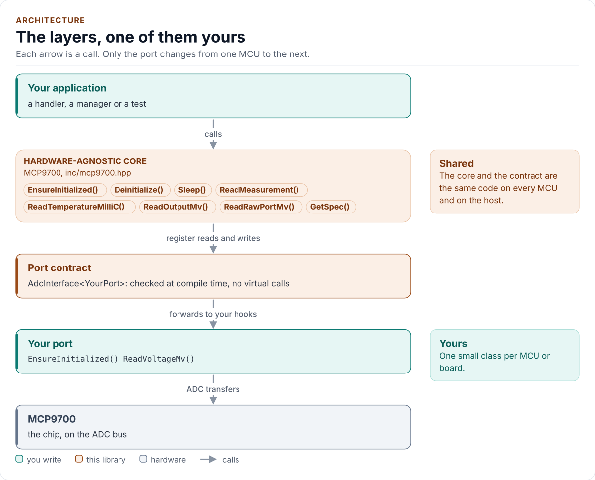
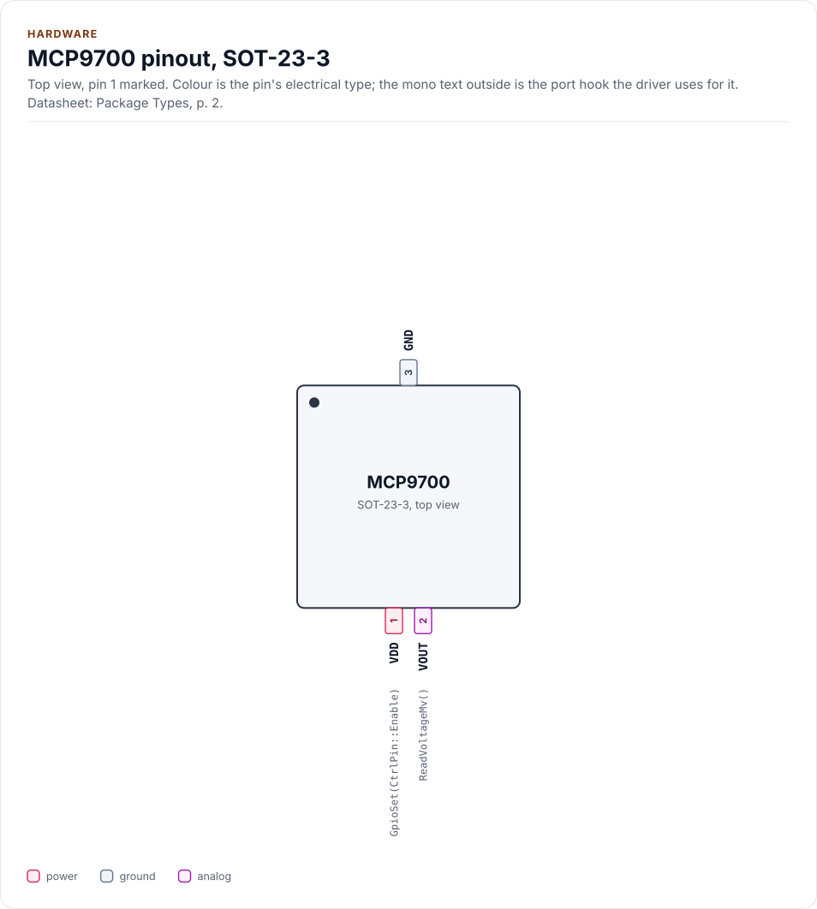
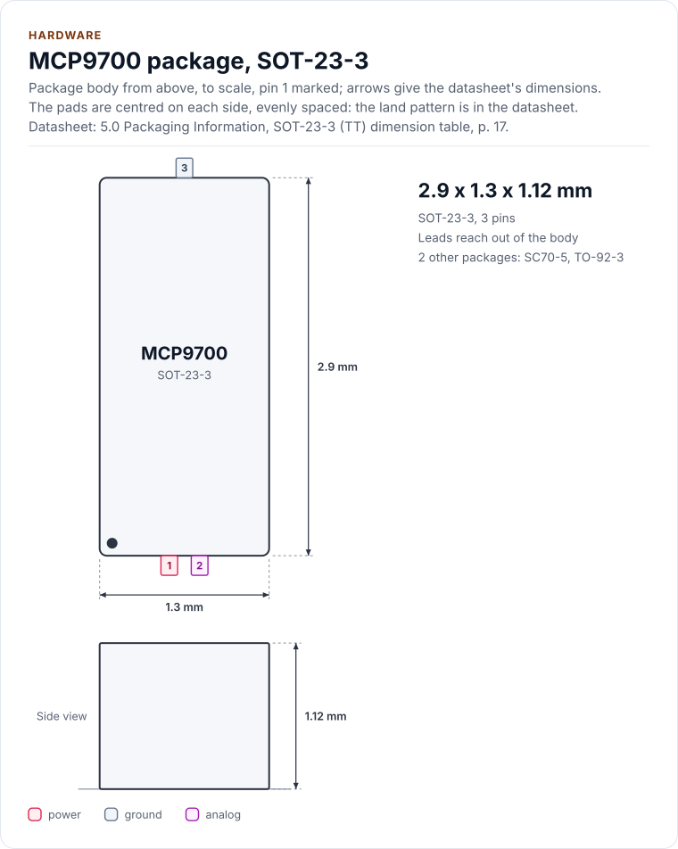
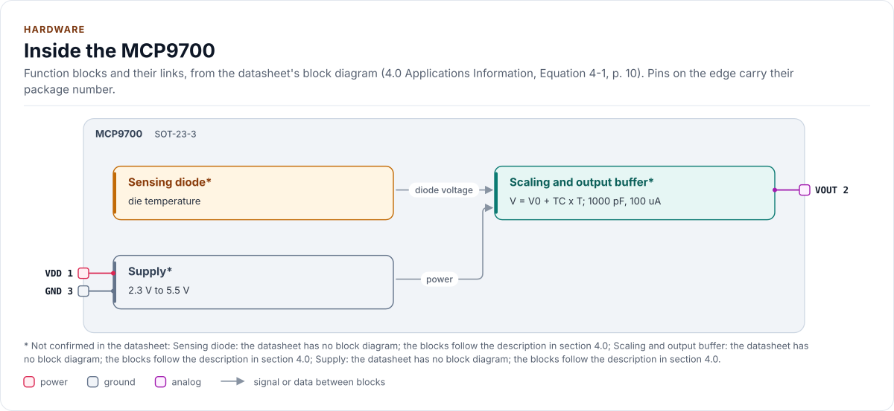

# MCP9700 Driver

C++20 driver for the Microchip MCP9700, MCP9700A, MCP9700B, MCP9701 and MCP9701A analog temperature sensors, read
through your ADC, with clip, noise and range checks.

[](https://github.com/kokeb-labs-drivers/driver-mcp9700/actions/workflows/ci.yml)
[](LICENSE)
[](docs/installation.md#requirements)

**Documentation: [`docs/`](docs/index.md)**, with the API reference built by Doxygen ([how](docs/api-reference.md)).
The site at <https://kokeb-labs-drivers.github.io/driver-mcp9700/> opens when the repository is public.

The MCP9700 family are analog temperature sensors: the output voltage rises with the temperature, 10 mV per degree
from 500 mV at 0 °C (19.5 mV per degree from 400 mV for the MCP9701 and MCP9701A). This driver powers the sensor,
checks that the channel carries a plausible, stable, unclipped voltage, averages several conversions, rejects a clipped
ADC, a noisy line and an output outside the specified range, and turns the voltage into milli-degrees with the
datasheet's transfer function or your one-point calibration, in integers. It runs on any MCU: you give it a small class
that reads one ADC channel in millivolts, and it does the rest. Another linear active thermistor IC with a positive
slope works through an explicit `Custom` variant that you declare completely.

<!-- figure: driver-layers -->
<picture>
  <source media="(prefers-color-scheme: dark)" srcset="docs/diagrams/driver-layers.dark.svg">
  
</picture>
<!-- /figure -->

## At a glance

| | |
| --- | --- |
| **Chips** | Microchip MCP9700, MCP9700A, MCP9700B, MCP9701, MCP9701A (the whole family, one table row each), SOT-23-3, SC70-5, TO-92-3 |
| **Measures** | -40 °C to +125 °C (+150 °C with the High option), -10 °C to +125 °C for the MCP9701 family |
| **Output** | 500 mV at 0 °C and 10.0 mV/°C (MCP9701: 400 mV and 19.5 mV/°C), typical; accuracy ±1 °C to ±4 °C by grade |
| **Bus** | None: one analog output to an MCU ADC channel, read in millivolts by your port |
| **Also drives** | The sensor's supply from an MCU pin, when your port has `GpioSet()` (`Sleep()`) |
| **Checks** | Clipped ADC (`Saturated`), noisy line (`Unstable`), output outside the range (`OutputLow`, `OutputHigh`) |
| **Driver** | Header-only C++20; integers only; no heap, exceptions, RTTI or virtual calls; every call returns `Result<T>` |
| **Runs on** | Any MCU with an ADC and a C++20 compiler; examples for ESP32 (ESP-IDF) and the host ([Platforms](docs/platforms.md)) |
| **Status** | 0.1.0, **not verified on hardware**: host-tested against a model of the sensor and the ADC and fuzzed; the bench steps are in [Limitations](docs/limitations.md) |

<!-- figure: chip-pinout -->
<picture>
  <source media="(prefers-color-scheme: dark)" srcset="docs/diagrams/chip-pinout.dark.svg">
  
</picture>
<!-- /figure -->

<!-- figure: chip-outline -->
<picture>
  <source media="(prefers-color-scheme: dark)" srcset="docs/diagrams/chip-outline.dark.svg">
  
</picture>
<!-- /figure -->

<!-- figure: chip-blocks -->
<picture>
  <source media="(prefers-color-scheme: dark)" srcset="docs/diagrams/chip-blocks.dark.svg">
  
</picture>
<!-- /figure -->

<!-- generated: chip-card -->
| | | Datasheet |
| --- | --- | --- |
| **Package** | SOT-23-3 | Package Types, [p. 2](https://ww1.microchip.com/downloads/aemDocuments/documents/MSLD/ProductDocuments/DataSheets/MCP970X-Family-Data-Sheet-DS20001942.pdf#page=2) |
| **Pins** | 3 | Package Types, [p. 2](https://ww1.microchip.com/downloads/aemDocuments/documents/MSLD/ProductDocuments/DataSheets/MCP970X-Family-Data-Sheet-DS20001942.pdf#page=2) |
| **Body size** | 2.9 x 1.3 x 1.12 mm | 5.0, [p. 17](https://ww1.microchip.com/downloads/aemDocuments/documents/MSLD/ProductDocuments/DataSheets/MCP970X-Family-Data-Sheet-DS20001942.pdf#page=17) |
| **Variants** | `sc70`, `to92` (below) | 5.0, [p. 14](https://ww1.microchip.com/downloads/aemDocuments/documents/MSLD/ProductDocuments/DataSheets/MCP970X-Family-Data-Sheet-DS20001942.pdf#page=14) |
| **Supply VDD (MCP9700, MCP9700A, MCP9700B)** | 2.3 V to 5.5 V | DC Electrical Characteristics, [p. 3](https://ww1.microchip.com/downloads/aemDocuments/documents/MSLD/ProductDocuments/DataSheets/MCP970X-Family-Data-Sheet-DS20001942.pdf#page=3) |
| **Supply VDD (MCP9701, MCP9701A)** | 3.1 V to 5.5 V | DC Electrical Characteristics, [p. 3](https://ww1.microchip.com/downloads/aemDocuments/documents/MSLD/ProductDocuments/DataSheets/MCP970X-Family-Data-Sheet-DS20001942.pdf#page=3) |

Also sold as:

| Variant | Package | Pins | Size | Ordering | Note | Datasheet |
| --- | --- | --- | --- | --- | --- | --- |
| `sc70` | SC70-5 | 5 | 2.00 x 1.25 x 1.10 mm (maximum height) | LT | VDD 4, VOUT 3, GND 2, pins 1 and 5 not connected; pitch 0.65 mm; every device | 5.0, [p. 14](https://ww1.microchip.com/downloads/aemDocuments/documents/MSLD/ProductDocuments/DataSheets/MCP970X-Family-Data-Sheet-DS20001942.pdf#page=14) |
| `to92` | TO-92-3 | 3 | 4.45 to 5.21 x 4.32 to 5.33 mm body | TO | 0.175 to 0.205 x 0.170 to 0.210 in; VDD 1, VOUT 2, GND 3 from the bottom view; pitch 1.27 mm; not the MCP9700B | 5.0, [p. 20](https://ww1.microchip.com/downloads/aemDocuments/documents/MSLD/ProductDocuments/DataSheets/MCP970X-Family-Data-Sheet-DS20001942.pdf#page=20) |

From [`docs/hardware.yml`](docs/hardware.yml); pins, circuits and the block diagram: [Hardware](docs/hardware.md).
<!-- /generated -->

The pins differ by package (the figure above is the SOT-23-3):

| Signal | SOT-23-3 | SC70-5 | TO-92-3 (bottom view) |
| --- | --- | --- | --- |
| VDD | 1 | 4 | 1 |
| VOUT | 2 | 3 | 2 |
| GND | 3 | 2 | 3 |
| NC | none | 1, 5 | none |

## Datasheet

<!-- generated: datasheet-card -->
| Document | Revision | Get it |
| --- | --- | --- |
| Datasheet: MCP970X Low-Power Linear Active Thermistor ICs (Microchip Technology Inc. DS20001942) | L, 2024-02 | [PDF](https://ww1.microchip.com/downloads/aemDocuments/documents/MSLD/ProductDocuments/DataSheets/MCP970X-Family-Data-Sheet-DS20001942.pdf) · [vendor page](https://www.microchip.com/en-us/product/MCP9700) |

Written against these revisions; the SHA-256 of each file is in [`docs/datasheets.yml`](docs/datasheets.yml). Where each
part of the driver is in the datasheet: [Datasheet map](docs/datasheet.md).
<!-- /generated -->

Every docs page lists the datasheet sections it relies on, and code comments cite the section they implement.

## Try it on your PC

No hardware needed: [`examples/host`](examples/host/README.md) runs the driver against a simulated part.
You need git, CMake 3.16+ and a C++20 compiler (GCC 10+, Clang 13+ or MSVC 2022).

1. Get the source:

   ```bash
   git clone https://github.com/kokeb-labs-drivers/driver-mcp9700.git && cd driver-mcp9700
   ```

2. Build and run the example:

   ```bash
   cmake -S examples/host -B build-example
   cmake --build build-example
   ./build-example/mcp9700_host_example
   ```

3. You should see the sensor started, read at three temperatures, calibrated, pulled out and put to sleep:

   ```text
   MCP970x driver 0.1.0 on the host
   one ADC step is 81 mC
   true 25 C: VOUT 750 mV, spread 0 mV, reads 25.000 C
   true 85 C: VOUT 1350 mV, spread 0 mV, reads 85.000 C
   true -10 C: VOUT 400 mV, spread 0 mV, reads -10.000 C
   as float: -10.0 C
   part reads 28.000 C
   calibrated reads 25.000 C
   pulled out: OutputLow
   asleep: NotInitialized
   woken, reads 25.000 C
   ```

To run the whole test suite instead: `cmake -S . -B build -DMCP9700_BUILD_TESTS=ON && cmake --build build && ctest
--test-dir build`.

## Use it on your MCU

**1. Wire it** ([Hardware](docs/hardware.md) has the pin numbers of all three packages):

| MCU | Sensor | Notes |
| --- | --- | --- |
| ADC input | VOUT | The input must reach 2 V for an MCP9700, 3 V for an MCP9701; no resistor in series |
| 3.3 V | VDD | 100 nF to GND close to the pin; an MCP9701 or MCP9701A needs 3.1 V or more |
| GND | GND | Same ground as the ADC reference |

**2. Write the port**: a class with `EnsureInitialized()` (bring the ADC up), `ReadVoltageMv()` (one calibrated
conversion, in millivolts) and `DelayUs()`, about 20 lines on most SDKs. [Porting](docs/porting.md) has the contract
and a complete example.

**3. Read the temperature:**

<!-- generated: quickstart-code -->
```cpp
#include "mcp9700.hpp"

int read_board_temperature(MyPort& port, int32_t& milli_celsius) {
  mcp9700::MCP9700<MyPort> sensor(port); // no I/O yet: an MCP9700 on a 12 bit, 3.3 V ADC

  if (auto r = sensor.EnsureInitialized(); !r) { // 1. ADC up, settle, one validated reading
    return static_cast<int>(r.error);            //    DeviceIdMismatch: wrong channel or no sensor
  }
  const auto t = sensor.ReadTemperatureMilliC(); // 2. discard 1, average 8, check, convert
  if (!t) {
    return static_cast<int>(t.error); //    OutputLow, OutputHigh, Saturated, Unstable or Bus
  }
  milli_celsius = t.value; // 3. 25000 is 25.000 C
  return 0;
}
```
<!-- /generated -->

`EnsureInitialized()` is the only call that starts the sensor. Every other call returns `Error::NotInitialized`
until it has succeeded, and no read ever starts the sensor on its own.

## What it does

- Powers the sensor (when your port drives its supply), waits for it and checks that the channel carries a plausible,
  stable, unclipped voltage. That catches a dead, grounded or rail-high line; it cannot tell a sensor from a floating
  pin that holds a stable mid-scale level (see [Limitations](docs/limitations.md#what-it-does-not-do)).
- Reads the temperature through your MCU's ADC: dummy conversions, then an average of several, no retries, no clamping.
- Reports a clipped ADC, a moving line, and an output outside the specified range (the window, 8 °C wider than the
  specified range by default) as errors, never as a temperature. A line shorted to ground is recognised only when the
  ADC reads below the window's floor: 20 mV (MCP9700 family) or 49 mV (MCP9701 family) by default.
- Converts in integers with the datasheet transfer function of the part you declare (five rows of one table), a
  one-point calibration offset, or a `Custom` declaration.
- Returns `Result<T>` with an `Error` from every call: no exceptions, no heap, no RTTI, no virtual calls.

## Add it to your project

Pick the row that matches your build; each is a few steps, and [Installation](docs/installation.md) has the
details.

| Your build | Steps below |
| --- | --- |
| Plain CMake: STM32 (CubeMX), RP2040 (Pico SDK), nRF Connect, a host app | [A](#a-cmake-any-mcu) |
| ESP-IDF | [B](#b-esp-idf) |
| An SDK or OS image that installs libraries | [C](#c-installed-package) |

### A. CMake, any MCU

1. Add the driver as a submodule, pinned to the version you chose:

   ```bash
   git submodule add https://github.com/kokeb-labs-drivers/driver-mcp9700.git external/driver-mcp9700
   ```

2. In your `CMakeLists.txt`, after `project()`:

   ```cmake
   add_subdirectory(external/driver-mcp9700)
   target_link_libraries(my_app PRIVATE mcp9700::mcp9700)   # brings the headers and C++20
   ```

3. In your code, `#include "mcp9700.hpp"`, write the port ([Porting](docs/porting.md)) and build. A first build
   that compiles the quickstart above is the check that the driver is wired in.

### B. ESP-IDF

1. Add the driver under your project's `components/`; ESP-IDF finds it there and names it after the folder:

   ```bash
   git submodule add https://github.com/kokeb-labs-drivers/driver-mcp9700.git components/mcp9700
   ```

2. In `main/CMakeLists.txt`, list it: `idf_component_register(SRCS "main.cpp" REQUIRES mcp9700)`.
3. `idf.py menuconfig` now has an **MCP970x analog temperature sensor** menu (part, ADC channel and full scale,
   conversions averaged),
   and `idf.py build` builds the driver with your app. [`examples/esp32`](examples/esp32) is a complete
   project with a port for the board.

### C. Installed package

1. Install it once into a prefix:

   ```bash
   cmake -S external/driver-mcp9700 -B build-mcp9700 && cmake --install build-mcp9700 --prefix /opt/sdk
   ```

2. In your project, with `CMAKE_PREFIX_PATH=/opt/sdk`:

   ```cmake
   find_package(mcp9700 0.1 REQUIRED)
   target_link_libraries(my_app PRIVATE mcp9700::mcp9700)
   ```

The target is `mcp9700::mcp9700` every way, so switching later changes nothing else.

## Documentation

| Page | Read it when you want to |
| --- | --- |
| [Quickstart](docs/quickstart.md) | Go from a bare sensor to a temperature on your MCU |
| [Hardware](docs/hardware.md) | Wire it: the five parts, packages and pins, the output, the ADC, the accuracy and the power |
| [Transfer function](docs/transfer-function.md) | See how a voltage becomes a temperature, and the error budget |
| [Porting](docs/porting.md) | Write the port class for your MCU's SDK |
| [API guide](docs/api-guide.md) | Use each call: start, read, calibrate, handle errors |
| [Configuration](docs/configuration.md) | Choose the part, the ADC, the averaging, the calibration or a `Custom` sensor |
| [Troubleshooting](docs/troubleshooting.md) | Find the cause of an error or a wrong reading |
| [Limitations](docs/limitations.md) | See what it assumes where the datasheet is silent, and what is not verified |
| [Contract](docs/contract.md) | Know exactly what the driver promises, needs and returns |
| [Datasheet map](docs/datasheet.md) | Find the datasheet section behind each part of the driver |
| [API reference](docs/api-reference.md) | Look up a class or member (Doxygen; built by CI and locally) |

## Tests and quality

```bash
cmake -S . -B build -DMCP9700_BUILD_TESTS=ON && cmake --build build && ctest --test-dir build
```

The host tests run the driver against a model of the sensor and the ADC, check it against a second implementation, and
produce each error the driver can return. A fuzzer fails conversions and returns any voltage, and checks the
driver's promises after every call. CI also
builds for Cortex-M and gates coverage, complexity, sanitizers, fuzzing, clang-tidy, cppcheck and the handbook
rules (`.kokeb/handbook.yml`). See [Testing and CI](docs/testing.md), which lists every gate and its limit.

## License

MIT. See [LICENSE](LICENSE).
