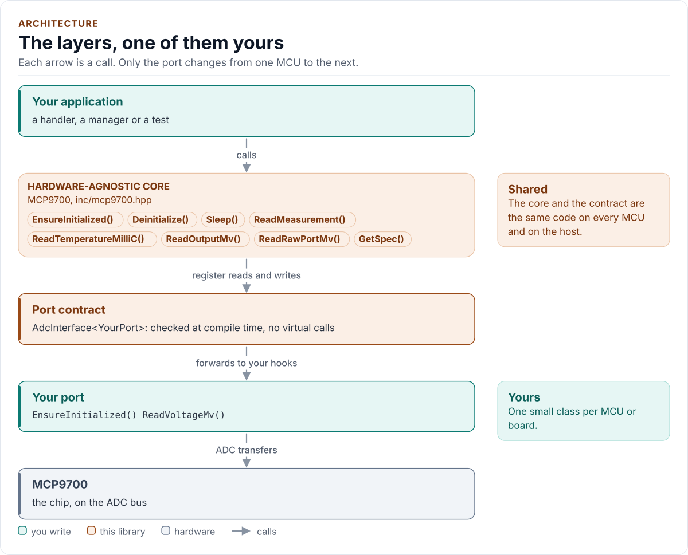
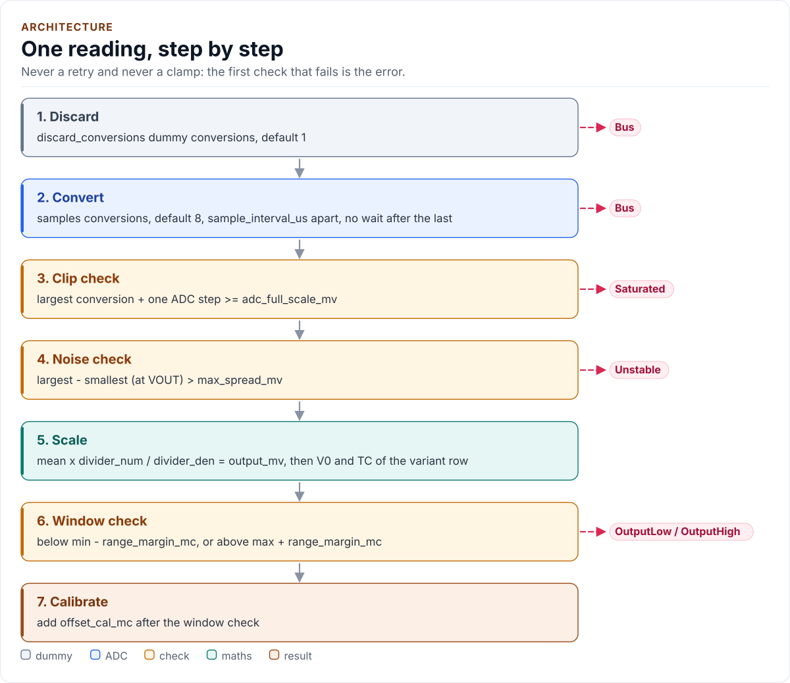

# Architecture

How the driver is built: the core, the port contract, and your port; and what one reading does.

<!-- generated: datasheet-refs -->
??? abstract "Datasheet sections this page relies on"

    From Microchip Technology Inc. DS20001942 L:

    - Output voltage range and an output outside it: 3.2 Output Voltage Pin (VOUT), [p. 9](https://ww1.microchip.com/downloads/aemDocuments/documents/MSLD/ProductDocuments/DataSheets/MCP970X-Family-Data-Sheet-DS20001942.pdf#page=9)

    All of them, with the driver API for each: [Datasheet map](datasheet.md).
<!-- /generated -->

<!-- figure: driver-layers -->
<picture>
  <source media="(prefers-color-scheme: dark)" srcset="diagrams/driver-layers.dark.svg">
  
</picture>
<!-- /figure -->

| Layer | Files | Owns |
| --- | --- | --- |
| Core | [`inc/mcp9700.hpp`](../inc/mcp9700.hpp), [`src/mcp9700.ipp`](../src/mcp9700.ipp) | Lifecycle, sampling, the clip, noise and range checks |
| Types | [`inc/mcp9700_types.hpp`](../inc/mcp9700_types.hpp) | `Error`, `Result<T>`, `Config`, the variant table, the conversion functions, presets |
| Compile-time helpers | [`inc/mcp9700_detail.hpp`](../inc/mcp9700_detail.hpp) | Typed integer literals, exact hook probes, enumeration checks |
| Port contract | [`inc/mcp9700_adc_interface.hpp`](../inc/mcp9700_adc_interface.hpp) | The CRTP base, `CtrlPin`, `GpioSignal`, the `AdcPort` concept, the output-load limits |
| Platform port | Your class | ADC bring-up, calibrated conversions, delay, optional supply pin |

An analog sensor has no registers, so there is no register layer: the "chip definition" is the variant table, which
is data (V0, TC, ranges, accuracy, packages) read by pure `constexpr` functions. A code path never asks which part it
is; it asks the row. `Variant::Custom` builds a row from the user's declaration and uses exactly the same code.

## One reading

<!-- figure: read-pipeline -->
<picture>
  <source media="(prefers-color-scheme: dark)" srcset="diagrams/read-pipeline.dark.svg">
  
</picture>
<!-- /figure -->

1. **Discard.** `discard_conversions` conversions whose value is thrown away.
2. **Convert.** `samples` conversions, `sample_interval_us` between every two and none after the last. A failed
   conversion stops the reading at once with `Bus`: nothing is retried, and the conversions so far are dropped.
3. **Clip check.** If the largest conversion plus one ADC step reaches the declared full scale, the ADC clipped:
   `Saturated`. The sensor's own output is far below any sensible full scale, so a clip is always a fault.
4. **Noise check.** If the largest minus the smallest conversion, scaled to VOUT, exceeds `max_spread_mv`:
   `Unstable`. A floating input does this.
5. **Scale and convert.** The mean, the divider and the transfer function are one integer expression, with one
   rounding at the end ([Transfer function](transfer-function.md)).
6. **Window check.** The temperature against the specified range plus the margin: `OutputLow` or `OutputHigh`.
7. **Calibrate.** `offset_cal_mc` is added to the temperature; the window check has already passed.

The first failing check is the error: `Bus` beats `Saturated`, which beats `Unstable`, which beats `OutputLow` and
`OutputHigh`. The order matters: a clipped conversion has no meaningful spread, and a floating line has no meaningful
temperature.

## Start-up

`EnsureInitialized()` resolves the variant row, brings the port's ADC up, switches the sensor on if the port can,
waits `power_on_settle_us` and takes one validated reading. The reading is a weak analogue of a chip-ID check: a
plausible, stable, unclipped output on the channel rules out a dead, grounded or rail-high line, but a floating pin that
holds a stable mid-scale level passes too (see [Limitations](limitations.md#what-it-does-not-do)). If it fails, the
sensor is switched off again (best effort), the driver stays uninitialised, and the reason is logged and mapped to
`DeviceIdMismatch` (or `Bus` when a conversion or the port failed). A failed write of the supply pin also ends in a
best-effort switch-off, because the write may have powered the sensor.

Next: [Contract](contract.md).
