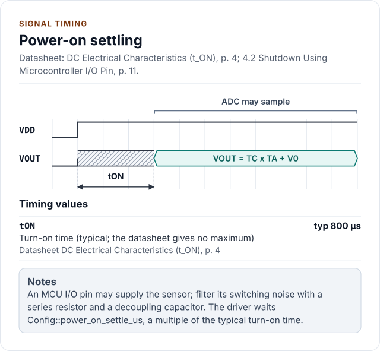

# On the bus

The MCP9700 has no serial bus: one analog output goes to an ADC channel, which your port reads in millivolts. The only
timing the driver depends on is the turn-on time after the sensor is powered, drawn below with the datasheet's value.
The pins and the ADC are on the [Hardware](hardware.md) page.

<!-- generated: datasheet-refs -->
??? abstract "Datasheet sections this page relies on"

    From Microchip Technology Inc. DS20001942 L:

    - Turn-on time: DC Electrical Characteristics (t_ON), [p. 4](https://ww1.microchip.com/downloads/aemDocuments/documents/MSLD/ProductDocuments/DataSheets/MCP970X-Family-Data-Sheet-DS20001942.pdf#page=4)
    - Shutdown from an I/O pin: 4.2 Shutdown Using Microcontroller I/O Pin, [p. 11](https://ww1.microchip.com/downloads/aemDocuments/documents/MSLD/ProductDocuments/DataSheets/MCP970X-Family-Data-Sheet-DS20001942.pdf#page=11)

    All of them, with the driver API for each: [Datasheet map](datasheet.md).
<!-- /generated -->

## Signal timing

When the port can switch the sensor's supply from an MCU pin, `EnsureInitialized()` raises it and waits
`Config::power_on_settle_us` before the first conversion. The datasheet gives the turn-on time as 800 µs typical with
no maximum, so the default wait is three times that, 2400 µs.

<!-- figure: power-on-timing -->
<picture>
  <source media="(prefers-color-scheme: dark)" srcset="diagrams/power-on-timing.dark.svg">
  
</picture>
<!-- /figure -->

## Several devices

Each sensor has its own output, so several sensors need one ADC channel each; they may share the supply and the
ground. The datasheet describes no shared line, so there is no topology figure.

## How these figures are made

Each figure is a model in `docs/model/` (`power-on-timing.timing.yml`) that cites the datasheet section and page of
every number; `kokeb-docs figures` draws it and the build fails on a number without a citation. The values table
under the waveform is also written as `docs/diagrams/power-on-timing.table.html`.
