# Figures

<!-- Written by kokeb-docs figures from docs/diagrams/figures/*.py. Do not edit by hand. -->

Every figure on this site is drawn by a Python module from facts extracted from the code, so it is rebuilt,
not redrawn, when the code changes. CI runs `kokeb-docs figures --check` and fails when a
committed figure no longer matches the code. Each figure below lists the files it is drawn from.

## Inside the MCP9700

<!-- figure: chip-blocks -->
<picture>
  <source media="(prefers-color-scheme: dark)" srcset="chip-blocks.dark.svg">
  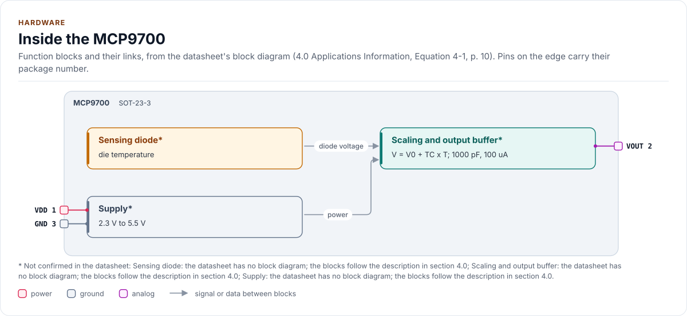
</picture>
<!-- /figure -->

Hardware description: [`docs/hardware.yml`](../hardware.yml)

Drawn from:

- [`docs/hardware.yml`](../hardware.yml)
- [`inc/mcp9700.hpp`](../../inc/mcp9700.hpp)
- [`inc/mcp9700_adc_interface.hpp`](../../inc/mcp9700_adc_interface.hpp)

## What the MCP9700 does

<!-- figure: chip-capabilities -->
<picture>
  <source media="(prefers-color-scheme: dark)" srcset="chip-capabilities.dark.svg">
  
</picture>
<!-- /figure -->

Hardware description: [`docs/hardware.yml`](../hardware.yml)

Drawn from:

- [`docs/hardware.yml`](../hardware.yml)
- [`inc/mcp9700.hpp`](../../inc/mcp9700.hpp)
- [`inc/mcp9700_adc_interface.hpp`](../../inc/mcp9700_adc_interface.hpp)

## MCP9700: Powered from an I/O pin

<!-- figure: chip-circuit-gpio-powered -->
<picture>
  <source media="(prefers-color-scheme: dark)" srcset="chip-circuit-gpio-powered.dark.svg">
  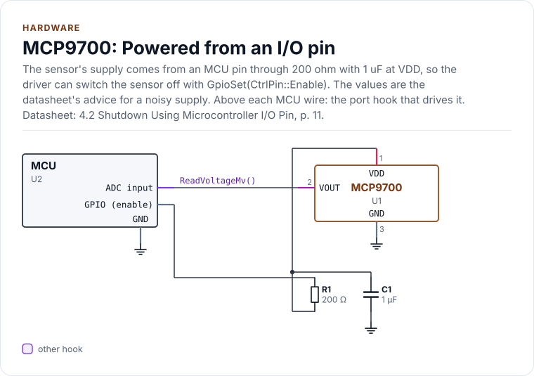
</picture>
<!-- /figure -->

Hardware description: [`docs/hardware.yml`](../hardware.yml)

Drawn from:

- [`docs/hardware.yml`](../hardware.yml)
- [`inc/mcp9700.hpp`](../../inc/mcp9700.hpp)
- [`inc/mcp9700_adc_interface.hpp`](../../inc/mcp9700_adc_interface.hpp)

## MCP9700: Typical application

<!-- figure: chip-circuit-typical -->
<picture>
  <source media="(prefers-color-scheme: dark)" srcset="chip-circuit-typical.dark.svg">
  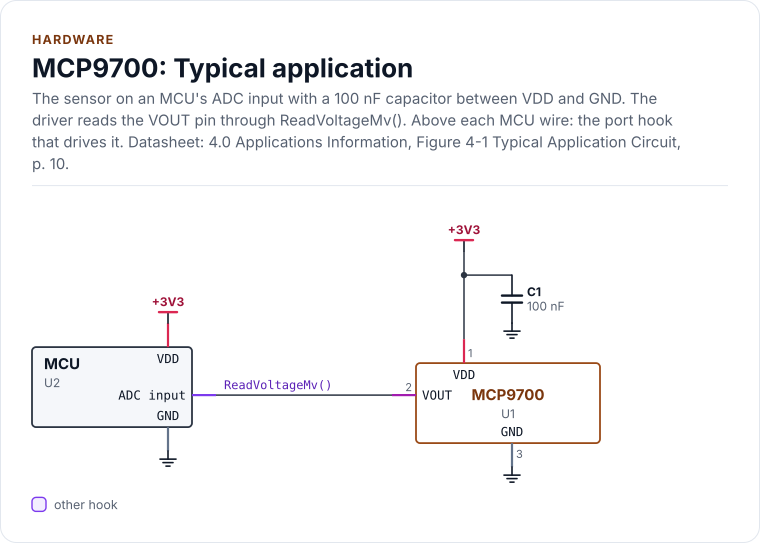
</picture>
<!-- /figure -->

Hardware description: [`docs/hardware.yml`](../hardware.yml)

Drawn from:

- [`docs/hardware.yml`](../hardware.yml)
- [`inc/mcp9700.hpp`](../../inc/mcp9700.hpp)
- [`inc/mcp9700_adc_interface.hpp`](../../inc/mcp9700_adc_interface.hpp)

## MCP9700

<!-- figure: chip-hero -->
<picture>
  <source media="(prefers-color-scheme: dark)" srcset="chip-hero.dark.svg">
  
</picture>
<!-- /figure -->

Hardware description: [`docs/hardware.yml`](../hardware.yml)

Drawn from:

- [`docs/hardware.yml`](../hardware.yml)
- [`inc/mcp9700.hpp`](../../inc/mcp9700.hpp)
- [`inc/mcp9700_adc_interface.hpp`](../../inc/mcp9700_adc_interface.hpp)

## MCP9700 package, SOT-23-3

<!-- figure: chip-outline -->
<picture>
  <source media="(prefers-color-scheme: dark)" srcset="chip-outline.dark.svg">
  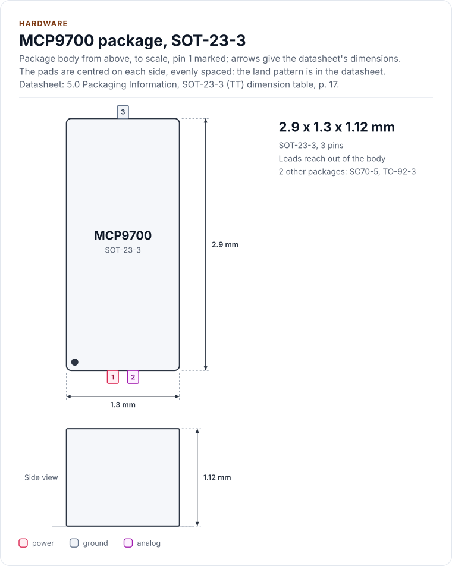
</picture>
<!-- /figure -->

Hardware description: [`docs/hardware.yml`](../hardware.yml)

Drawn from:

- [`docs/hardware.yml`](../hardware.yml)
- [`inc/mcp9700.hpp`](../../inc/mcp9700.hpp)
- [`inc/mcp9700_adc_interface.hpp`](../../inc/mcp9700_adc_interface.hpp)

## MCP9700 pinout, SOT-23-3

<!-- figure: chip-pinout -->
<picture>
  <source media="(prefers-color-scheme: dark)" srcset="chip-pinout.dark.svg">
  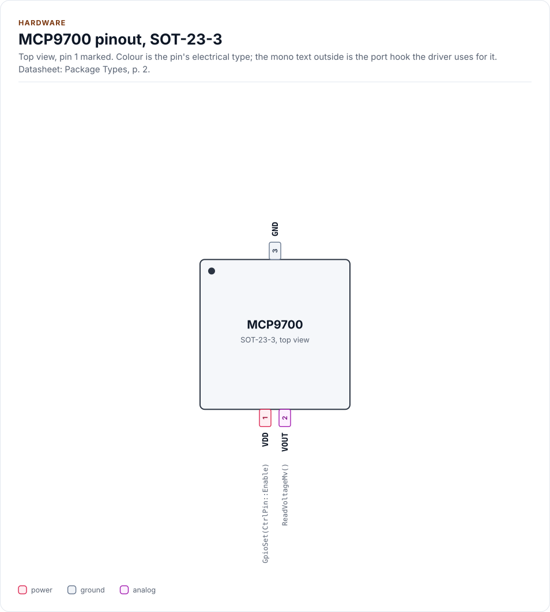
</picture>
<!-- /figure -->

Hardware description: [`docs/hardware.yml`](../hardware.yml)

Drawn from:

- [`docs/hardware.yml`](../hardware.yml)
- [`inc/mcp9700.hpp`](../../inc/mcp9700.hpp)
- [`inc/mcp9700_adc_interface.hpp`](../../inc/mcp9700_adc_interface.hpp)

## Wiring: Powered from an I/O pin

<!-- figure: chip-wiring-gpio-powered -->
<picture>
  <source media="(prefers-color-scheme: dark)" srcset="chip-wiring-gpio-powered.dark.svg">
  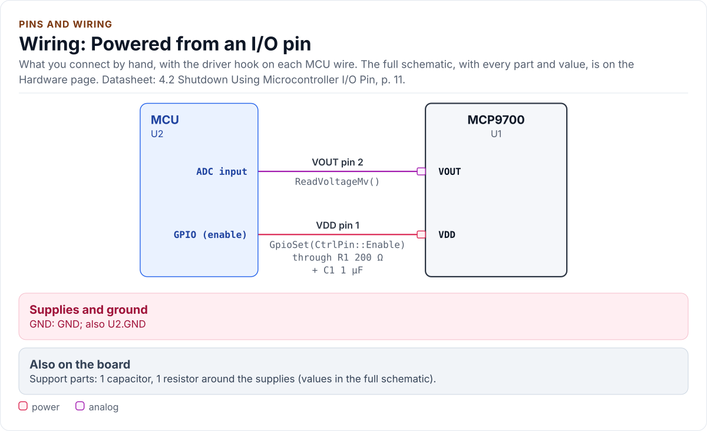
</picture>
<!-- /figure -->

Hardware description: [`docs/hardware.yml`](../hardware.yml)

Drawn from:

- [`docs/hardware.yml`](../hardware.yml)
- [`inc/mcp9700.hpp`](../../inc/mcp9700.hpp)
- [`inc/mcp9700_adc_interface.hpp`](../../inc/mcp9700_adc_interface.hpp)

## Wiring: Typical application

<!-- figure: chip-wiring-typical -->
<picture>
  <source media="(prefers-color-scheme: dark)" srcset="chip-wiring-typical.dark.svg">
  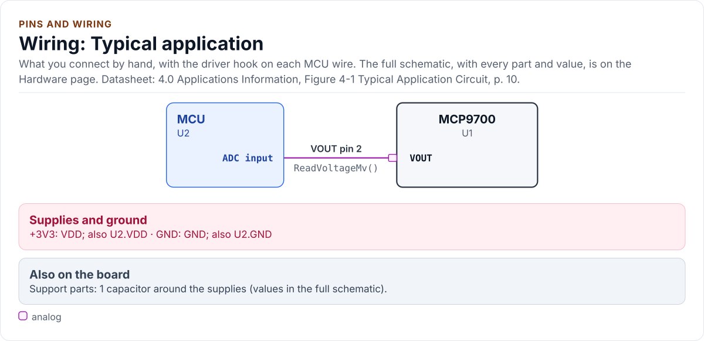
</picture>
<!-- /figure -->

Hardware description: [`docs/hardware.yml`](../hardware.yml)

Drawn from:

- [`docs/hardware.yml`](../hardware.yml)
- [`inc/mcp9700.hpp`](../../inc/mcp9700.hpp)
- [`inc/mcp9700_adc_interface.hpp`](../../inc/mcp9700_adc_interface.hpp)

## The layers, one of them yours

<!-- figure: driver-layers -->
<picture>
  <source media="(prefers-color-scheme: dark)" srcset="driver-layers.dark.svg">
  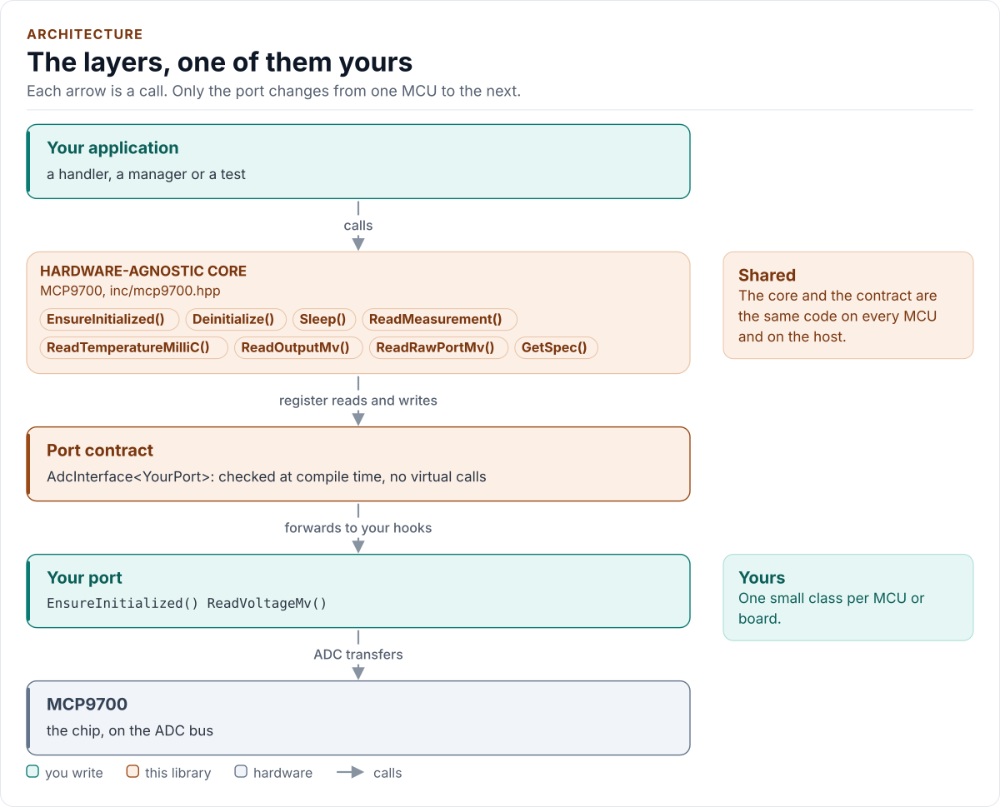
</picture>
<!-- /figure -->

Figure module: [`docs/diagrams/figures/driver-layers.py`](../../docs/diagrams/figures/driver-layers.py)

Drawn from:

- `public calls` in [`inc/mcp9700.hpp`](../../inc/mcp9700.hpp)
- `AdcInterface` in [`inc/mcp9700_adc_interface.hpp`](../../inc/mcp9700_adc_interface.hpp)

## Power-on settling

<!-- figure: power-on-timing -->
<picture>
  <source media="(prefers-color-scheme: dark)" srcset="power-on-timing.dark.svg">
  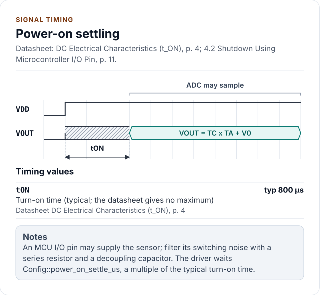
</picture>
<!-- /figure -->

Hardware description: [`docs/model/power-on-timing.timing.yml`](../model/power-on-timing.timing.yml)

Drawn from:

- [`docs/model/power-on-timing.timing.yml`](../model/power-on-timing.timing.yml)

## One reading, step by step

<!-- figure: read-pipeline -->
<picture>
  <source media="(prefers-color-scheme: dark)" srcset="read-pipeline.dark.svg">
  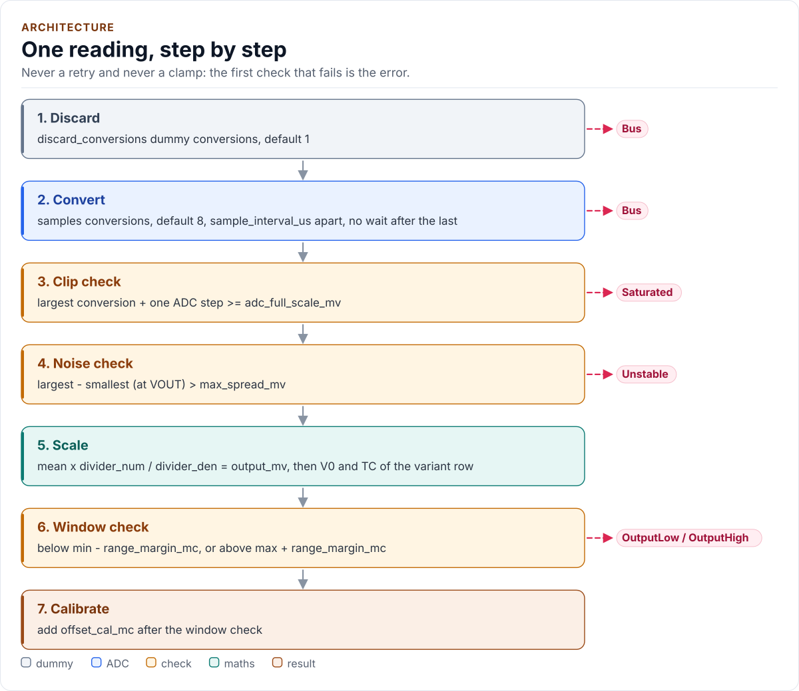
</picture>
<!-- /figure -->

Figure module: [`docs/diagrams/figures/read-pipeline.py`](../../docs/diagrams/figures/read-pipeline.py)

Drawn from:

- `collect()` in [`src/mcp9700.ipp`](../../src/mcp9700.ipp)
- `Evaluate()` in [`src/mcp9700.ipp`](../../src/mcp9700.ipp)
- `ReadMeasurement()` in [`src/mcp9700.ipp`](../../src/mcp9700.ipp)

## Output voltage against temperature

<!-- figure: transfer-function -->
<picture>
  <source media="(prefers-color-scheme: dark)" srcset="transfer-function.dark.svg">
  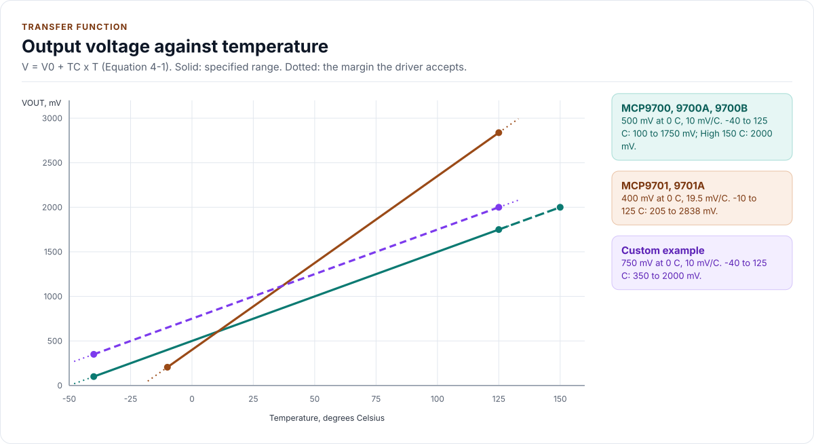
</picture>
<!-- /figure -->

Figure module: [`docs/diagrams/figures/transfer-function.py`](../../docs/diagrams/figures/transfer-function.py)

Drawn from:

- `kVariantTable` in [`inc/mcp9700_types.hpp`](../../inc/mcp9700_types.hpp)
- `range_margin_mc` in [`inc/mcp9700_types.hpp`](../../inc/mcp9700_types.hpp)
- `custom-offset` in [`tests/docs/configuration.cpp`](../../tests/docs/configuration.cpp)
