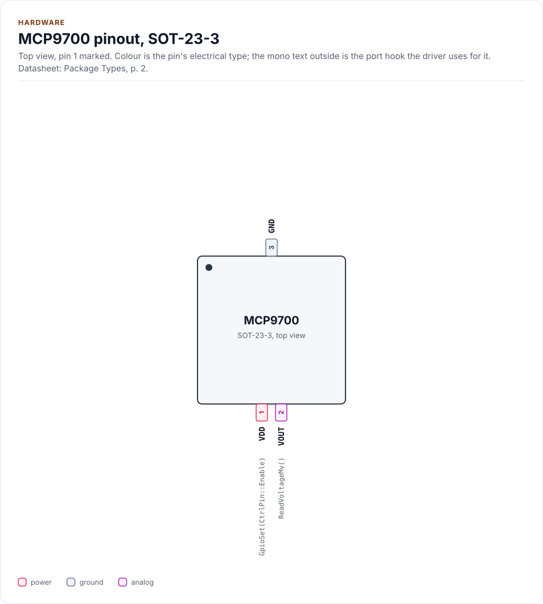
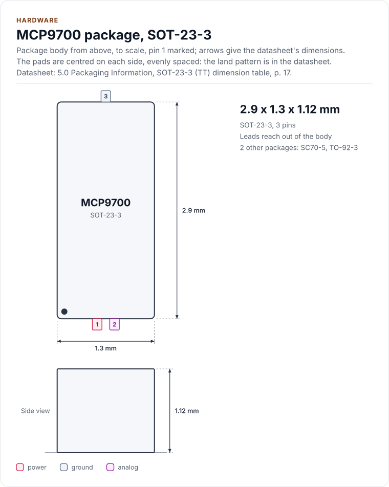
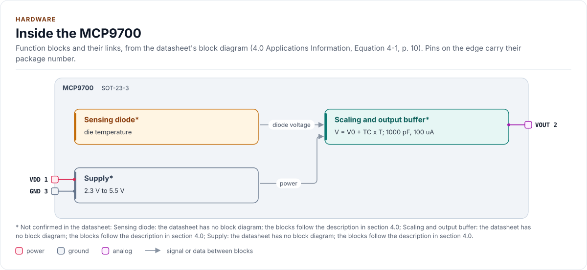
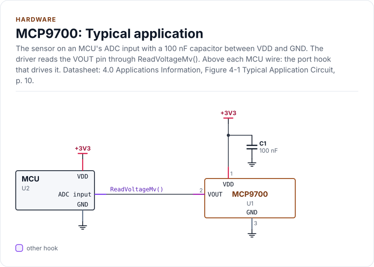
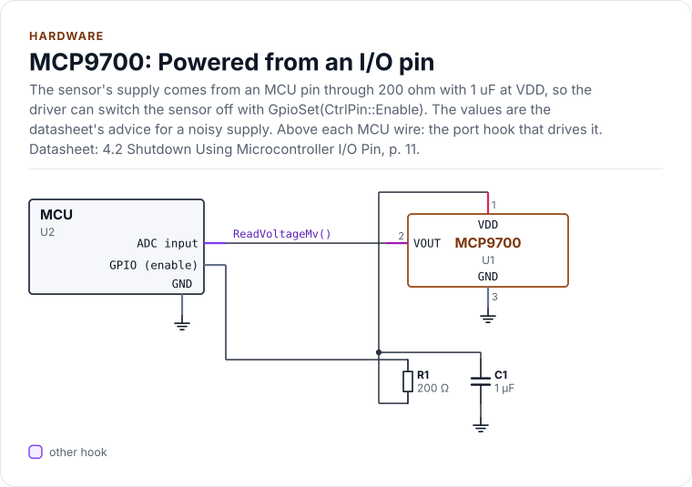

# Hardware

The MCP9700, MCP9700A, MCP9700B, MCP9701 and MCP9701A: the packages and pins, the output, the ADC in front of it,
the timing, the accuracy and the supply, as the driver uses them. Values are from the datasheet; when your
schematic disagrees on pin numbers, the schematic wins.

<!-- generated: datasheet-refs -->
??? abstract "Datasheet sections this page relies on"

    From Microchip Technology Inc. DS20001942 L:

    - Pins and packages: Package Types; 3.0 Pin Descriptions, Table 3-1, [p. 2](https://ww1.microchip.com/downloads/aemDocuments/documents/MSLD/ProductDocuments/DataSheets/MCP970X-Family-Data-Sheet-DS20001942.pdf#page=2)
    - Absolute maximum ratings: 1.0 Electrical Characteristics, [p. 3](https://ww1.microchip.com/downloads/aemDocuments/documents/MSLD/ProductDocuments/DataSheets/MCP970X-Family-Data-Sheet-DS20001942.pdf#page=3)
    - Supply range and current: DC Electrical Characteristics, [p. 3](https://ww1.microchip.com/downloads/aemDocuments/documents/MSLD/ProductDocuments/DataSheets/MCP970X-Family-Data-Sheet-DS20001942.pdf#page=3)
    - Output current, impedance and load capacitance: DC Electrical Characteristics (I_OUT, Z_OUT, C_LOAD), [p. 4](https://ww1.microchip.com/downloads/aemDocuments/documents/MSLD/ProductDocuments/DataSheets/MCP970X-Family-Data-Sheet-DS20001942.pdf#page=4)
    - Turn-on time: DC Electrical Characteristics (t_ON), [p. 4](https://ww1.microchip.com/downloads/aemDocuments/documents/MSLD/ProductDocuments/DataSheets/MCP970X-Family-Data-Sheet-DS20001942.pdf#page=4)
    - Specified temperature ranges: Temperature Characteristics, [p. 4](https://ww1.microchip.com/downloads/aemDocuments/documents/MSLD/ProductDocuments/DataSheets/MCP970X-Family-Data-Sheet-DS20001942.pdf#page=4)
    - Output voltage range and an output outside it: 3.2 Output Voltage Pin (VOUT), [p. 9](https://ww1.microchip.com/downloads/aemDocuments/documents/MSLD/ProductDocuments/DataSheets/MCP970X-Family-Data-Sheet-DS20001942.pdf#page=9)
    - Shutdown from an I/O pin: 4.2 Shutdown Using Microcontroller I/O Pin, [p. 11](https://ww1.microchip.com/downloads/aemDocuments/documents/MSLD/ProductDocuments/DataSheets/MCP970X-Family-Data-Sheet-DS20001942.pdf#page=11)
    - Layout and decoupling: 4.3 Layout Considerations, [p. 11](https://ww1.microchip.com/downloads/aemDocuments/documents/MSLD/ProductDocuments/DataSheets/MCP970X-Family-Data-Sheet-DS20001942.pdf#page=11)
    - Thermal considerations and self-heating: 4.4 Thermal Considerations, [p. 11](https://ww1.microchip.com/downloads/aemDocuments/documents/MSLD/ProductDocuments/DataSheets/MCP970X-Family-Data-Sheet-DS20001942.pdf#page=11)
    - Packaging drawings and ordering codes: 5.0 Packaging Information; Product Identification System, [p. 13](https://ww1.microchip.com/downloads/aemDocuments/documents/MSLD/ProductDocuments/DataSheets/MCP970X-Family-Data-Sheet-DS20001942.pdf#page=13)
    - The five devices and the packages each comes in: Product Identification System; 5.1 Package Marking, [p. 23](https://ww1.microchip.com/downloads/aemDocuments/documents/MSLD/ProductDocuments/DataSheets/MCP970X-Family-Data-Sheet-DS20001942.pdf#page=23)

    All of them, with the driver API for each: [Datasheet map](datasheet.md).
<!-- /generated -->

## The family

The datasheet lists exactly five devices. They are one first-order sensor in two scalings and three accuracy grades;
the driver holds each as one row of a table (`mcp9700::kVariantTable`) and never branches on a name.

| Device | V0 at 0 °C | Slope TC | Specified range | Supply | Accuracy tested at | Packages |
| --- | --- | --- | --- | --- | --- | --- |
| MCP9700 | 500 mV | 10.0 mV/°C | -40 to +125 °C (+150 °C High) | 2.3 to 5.5 V | VDD = 3.3 V | SOT-23-3, SC70-5, TO-92-3 |
| MCP9700A | 500 mV | 10.0 mV/°C | -40 to +125 °C | 2.3 to 5.5 V | VDD = 3.3 V | SOT-23-3, SC70-5, TO-92-3 |
| MCP9700B | 500 mV | 10.0 mV/°C | -40 to +125 °C (+150 °C High) | 2.3 to 5.5 V | VDD = 3.3 V | SOT-23-3, SC70-5 |
| MCP9701 | 400 mV | 19.5 mV/°C | -10 to +125 °C | 3.1 to 5.5 V | VDD = 5.0 V | SOT-23-3, SC70-5, TO-92-3 |
| MCP9701A | 400 mV | 19.5 mV/°C | -10 to +125 °C | 3.1 to 5.5 V | VDD = 5.0 V | SOT-23-3, SC70-5, TO-92-3 |

The High option (ordering code `H`, up to +150 °C) exists for the MCP9700 and MCP9700B in SOT-23-3 and SC70-5 only
(DC Electrical Characteristics, note 1, p. 3). The automotive-qualified `VAO` ordering suffix selects a
qualification, not a different device, so it is not a variant. The parts cannot be told apart at run time, so the
variant is something you declare in `Config`; the driver does not check the declaration (open question O-3 in
[Limitations](limitations.md)).

## Pins

The figures draw the SOT-23-3, the one package every device is sold in; SC70-5 and TO-92-3 are below. The pinout,
the outline, the block diagram, the circuits and the tables on this page are drawn from
[`docs/hardware.yml`](hardware.yml).

<!-- figure: chip-pinout -->
<picture>
  <source media="(prefers-color-scheme: dark)" srcset="diagrams/chip-pinout.dark.svg">
  
</picture>
<!-- /figure -->

<!-- generated: chip-pins -->
SOT-23-3, 3 pins (Package Types, [p. 2](https://ww1.microchip.com/downloads/aemDocuments/documents/MSLD/ProductDocuments/DataSheets/MCP970X-Family-Data-Sheet-DS20001942.pdf#page=2)).

| Pin | Name | Type (domain) | Function | Driver hook | Datasheet |
| --- | --- | --- | --- | --- | --- |
| 1 | `VDD` | power (VDD) | Supply, 2.3 V to 5.5 V (3.1 V to 5.5 V for the MCP9701 and MCP9701A); may be driven from an MCU pin through 200 ohm (optional hook) | `GpioSet(CtrlPin::Enable)` | 3.0, [p. 9](https://ww1.microchip.com/downloads/aemDocuments/documents/MSLD/ProductDocuments/DataSheets/MCP970X-Family-Data-Sheet-DS20001942.pdf#page=9) |
| 2 | `VOUT` | analog (VDD) | Output voltage, 10.0 mV/C and 500 mV at 0 C (MCP9701: 19.5 mV/C and 400 mV); 100 uA at most | `ReadVoltageMv()` | 3.2, [p. 9](https://ww1.microchip.com/downloads/aemDocuments/documents/MSLD/ProductDocuments/DataSheets/MCP970X-Family-Data-Sheet-DS20001942.pdf#page=9) |
| 3 | `GND` | ground | Ground | - | 3.0, [p. 9](https://ww1.microchip.com/downloads/aemDocuments/documents/MSLD/ProductDocuments/DataSheets/MCP970X-Family-Data-Sheet-DS20001942.pdf#page=9) |

Source of this table and of the chip figures: [`docs/hardware.yml`](hardware.yml).
<!-- /generated -->

| Signal | SOT-23-3 | TO-92-3 | SC70-5 | Function |
| --- | --- | --- | --- | --- |
| VDD | 1 | 1 | 4 | Supply input |
| VOUT | 2 | 2 | 3 | Output voltage |
| GND | 3 | 3 | 2 | Ground |
| NC | none | none | 1, 5 | Not connected to the die (Table 3-1, p. 9) |

The SC70-5 no-connect pins may be tied to a copper trace from the heat source to improve thermal contact (section
3.4, p. 9). The TO-92 pins are numbered in the bottom view, 1 2 3 from left to right.

### Package outline

<!-- figure: chip-outline -->
<picture>
  <source media="(prefers-color-scheme: dark)" srcset="diagrams/chip-outline.dark.svg">
  
</picture>
<!-- /figure -->

The figure shows the SOT-23-3 body: 2.90 mm long and 1.30 mm wide, at most 1.12 mm high (the maximum, A max; the
minimum is 0.89 mm), pitch 0.95 mm (drawing C04-104, p. 17). It is the body, not the land pattern: use the
datasheet's drawing for the footprint.

| Package | Ordering code | Body | Pitch | Height | Drawing |
| --- | --- | --- | --- | --- | --- |
| SOT-23-3 | `/TT` | 2.90 x 1.30 mm | 0.95 mm | 1.12 mm max | C04-104, p. 17 |
| SC70-5 | `/LT` | 2.00 x 1.25 mm (2.10 mm overall width) | 0.65 mm | 1.10 mm max | C04-061, p. 14 |
| TO-92-3 | `/TO` | 4.45 to 5.21 x 4.32 to 5.33 mm (0.175 to 0.205 x 0.170 to 0.210 in) | 1.27 mm | bottom to package flat 3.18 to 4.19 mm | C04-101, p. 20 |

The TO-92 drawing is in inches; the millimetre values are converted. The MCP9700B is not sold in TO-92-3, and the
High option is not sold in it either.

## Inside the chip

<!-- figure: chip-blocks -->
<picture>
  <source media="(prefers-color-scheme: dark)" srcset="diagrams/chip-blocks.dark.svg">
  
</picture>
<!-- /figure -->

The datasheet has no block diagram. Section 4.0 (p. 10) describes it: an internal diode measures the die
temperature, and its voltage is scaled to the output. The blocks above follow that description and are marked
unverified in the file for that reason.

## Circuits

The datasheet needs no part other than the sensor, and recommends 0.1 µF to 1 µF between VDD and GND, close to the
pins (section 4.3, p. 11).

<!-- figure: chip-circuit-typical -->
<picture>
  <source media="(prefers-color-scheme: dark)" srcset="diagrams/chip-circuit-typical.dark.svg">
  
</picture>
<!-- /figure -->

### Power from an I/O pin

Section 4.2 (p. 11) allows the sensor to be powered from an MCU pin, which lets the driver switch it off
(`Sleep()`). The pin's switching noise reaches the sensor as supply noise and spoils the accuracy, so the
datasheet asks for a decoupling capacitor and a series resistor: 200 Ω with 1 µF at VDD (section 4.3). Put the
resistor in the **supply** line; never in series with VOUT, which would add an error with the ADC's input current.

<!-- figure: chip-circuit-gpio-powered -->
<picture>
  <source media="(prefers-color-scheme: dark)" srcset="diagrams/chip-circuit-gpio-powered.dark.svg">
  
</picture>
<!-- /figure -->

<!-- generated: chip-parts -->
**Typical application** (figure `chip-circuit-typical`)

| Part | Kind | Value | Connects | Datasheet |
| --- | --- | --- | --- | --- |
| U2 | MCU | - | VDD: +3V3, GND: GND, ADC: VOUT | 4.0, [p. 10](https://ww1.microchip.com/downloads/aemDocuments/documents/MSLD/ProductDocuments/DataSheets/MCP970X-Family-Data-Sheet-DS20001942.pdf#page=10) |
| C1 | capacitor | 100 nF | +3V3, GND | 4.3, [p. 11](https://ww1.microchip.com/downloads/aemDocuments/documents/MSLD/ProductDocuments/DataSheets/MCP970X-Family-Data-Sheet-DS20001942.pdf#page=11) |

**Powered from an I/O pin** (figure `chip-circuit-gpio-powered`)

| Part | Kind | Value | Connects | Datasheet |
| --- | --- | --- | --- | --- |
| U2 | MCU | - | EN: SUPPLY, GND: GND, ADC: VOUT | 4.2, [p. 11](https://ww1.microchip.com/downloads/aemDocuments/documents/MSLD/ProductDocuments/DataSheets/MCP970X-Family-Data-Sheet-DS20001942.pdf#page=11) |
| R1 | resistor | 200 Ω | SUPPLY, VDD | 4.2, [p. 11](https://ww1.microchip.com/downloads/aemDocuments/documents/MSLD/ProductDocuments/DataSheets/MCP970X-Family-Data-Sheet-DS20001942.pdf#page=11) |
| C1 | capacitor | 1 µF | VDD, GND | 4.3, [p. 11](https://ww1.microchip.com/downloads/aemDocuments/documents/MSLD/ProductDocuments/DataSheets/MCP970X-Family-Data-Sheet-DS20001942.pdf#page=11) |

Export a circuit for a schematic or PCB tool: `kokeb-docs hardware --kicad-netlist OUT.net --circuit typical`.
<!-- /generated -->

The port drives the pin INACTIVE (unpowered) before it enables the pin's output, and `EnsureInitialized()` powers
the sensor with `GpioSet(CtrlPin::Enable, GpioSignal::ACTIVE)`. See [Porting](porting.md#control-pins).

## The output

Equation 4-1 (p. 10): **VOUT = TC x TA + V0 °C**. How the driver turns a
voltage into a temperature, with the rounding and the numbers, is on [Transfer function](transfer-function.md).

| Parameter | Value | Page | In the driver |
| --- | --- | --- | --- |
| Output range over the specified range | 100 mV to 1.75 V (MCP9700 family), 200 mV to 3 V (MCP9701 family) | 9 | the window of `OutputLow` and `OutputHigh` |
| Output current | 100 µA at most | 4 | `kMaxOutputCurrentUa` |
| Output impedance | 20 Ω typical, at 100 µA and 500 Hz | 4 | `kOutputImpedanceOhm` |
| Output load regulation | 2 Ω typical, 0 to +70 °C, 100 µA | 4 | not used by the code |
| Load capacitance | 1000 pF (characterised and production tested) | 4 | `kMaxLoadCapacitancePf` |
| Nonlinearity | ±0.5 °C typical, 0 to +70 °C | 4 | left in the result ([Limitations](limitations.md)) |
| Line regulation | 0.1 °C/V typical | 3 | not corrected |
| Operating current | 6 µA typical, 12 µA maximum (15 µA at +150 °C) | 3 | not used by the code |
| Turn-on time tON | 800 µs typical, no maximum | 4 | `Config::power_on_settle_us`, default 2400 µs |
| Thermal response tRES | 1.3 s (SC70 on a 1 x 1 inch board), 1.65 s (TO-92 in a fluid bath), to 63 % | 4 | caps the averaging window |

The output is not ratiometric to VDD: a 0.1 °C/V line regulation means the supply barely moves the reading, so the
driver needs the voltage at VOUT and nothing about the supply. An ADC that measures against its own supply does not
change that, as long as its port reports calibrated millivolts.

The datasheet does not give the output level of an unpowered or shut-down sensor, so the driver never relies on it.
`EnsureInitialized()` waits for the turn-on time and then checks the first reading; a sensor that is still off reads
as `OutputLow` or `Unstable`. The bench step to learn what your board shows is in
[Troubleshooting](troubleshooting.md).

## The ADC in front of it

The driver needs two numbers from you: the **full scale** of your port (the largest millivolt value it reports) and
its **resolution** in bits (`Config::adc_full_scale_mv`, `Config::adc_resolution_bits`). They set the size of one
step, and they let the driver tell a clipped conversion from a real one: a conversion within one step of the full
scale is `Saturated`, never a temperature. The sensor's own output never reaches the full scale of a sensible
setup, so a clip is always a fault (an open input, a wrong attenuation or a mis-declared scale).

| ADC | Full scale | One step at the pin | Step in temperature (9700) | (9701) |
| --- | --- | --- | --- | --- |
| 8 bit | 2500 mV | 9.8 mV | 977 m°C | |
| 10 bit | 3300 mV | 3.2 mV | 323 m°C | |
| 12 bit | 3100 mV | 0.76 mV | 76 m°C | |
| 12 bit | 3300 mV | 0.81 mV | 81 m°C | 42 m°C |
| 12 bit | 4096 mV | 1.0 mV | 100 m°C | |
| 12 bit | 5000 mV | 1.22 mV | | 63 m°C |
| 16 bit | 3300 mV | 0.05 mV | 6 m°C | |

`ResolutionMilliC()` returns the step for your configuration, rounded up. Averaging eight conversions lowers the
noise but not the step; the sensor's own accuracy (±1 °C to ±4 °C) is larger than any step above 10 bits.

The ADC's input must not draw more than 100 µA on average, including the charge of its sample-and-hold, and
VOUT should see no more than 1000 pF. If your ADC is a multiplexed one, its sample capacitor holds the previous
channel's voltage after a switch: the first conversion is wrong. The driver discards `discard_conversions`
conversions (default 1) before each reading for that reason. A voltage divider in front of the ADC is declared with
`divider_num` and `divider_den`; the driver scales back to the voltage at VOUT.

## Accuracy

Sensor accuracy is the error limit the datasheet guarantees over a span at its tested supply (p. 3). The driver
holds the limits (`AccuracyLimitsFor()`) so you can check a measurement against them, but it never applies them
to a reading.

| Device | Span | Error limits |
| --- | --- | --- |
| MCP9700B | +20 to +70 °C | -1 to +1 °C |
| MCP9700B | 0 to +125 °C | -2 to +3 °C |
| MCP9700B | -40 to +125 °C | -2 to +4 °C |
| MCP9700B, High option | -40 to +150 °C | -4 to +4 °C |
| MCP9700A, MCP9701A | 0 to +70 °C | -2 to +2 °C |
| MCP9700A | -40 to +125 °C | -2 to +4 °C |
| MCP9701A | -10 to +125 °C | -2 to +4 °C |
| MCP9700, MCP9701 | 0 to +70 °C | -4 to +4 °C |
| MCP9700 | -40 to +125 °C | -4 to +6 °C |
| MCP9701 | -10 to +125 °C | -4 to +6 °C |
| MCP9700, High option | -40 to +150 °C | -4 to +6 °C |

The narrowest span that contains the temperature wins. The datasheet's High-option rows cover the whole range to
+150 °C and it does not say that an H part also meets the tighter Extended rows (p. 3 labels only the -40 to +150 °C
rows "High Temperature"). So for `TemperatureClass::High` the driver uses the High-option rows alone, over the whole
range: the guarantee it reports is never tighter than the one the datasheet gives.

## Power and absolute maximums

| Rating | Value | Page |
| --- | --- | --- |
| Supply voltage VDD, absolute maximum | 6.0 V | 3 |
| Output current, absolute maximum | ±30 mA | 3 |
| Storage temperature | -65 °C to +150 °C | 3 |
| Junction temperature | 150 °C | 3 |
| Operating supply | 2.3 V to 5.5 V (MCP9701 family 3.1 V to 5.5 V) | 3 |
| Thermal resistance | SC70-5 331 °C/W, SOT-23-3 308 °C/W, TO-92-3 146 °C/W | 4 |

Self-heating at 25 °C with the maximum supply, current and load is 0.179 °C (section 4.4, p. 11): it is left in the
reading. The sensor measures the die, which follows the board through the pins far more than the air; for the air,
use the TO-92 package (section 4.4).

## Reference documents

The datasheet:
[MCP970X Low-Power Linear Active Thermistor ICs](https://ww1.microchip.com/downloads/aemDocuments/documents/MSLD/ProductDocuments/DataSheets/MCP970X-Family-Data-Sheet-DS20001942.pdf).
Every pin, setting and timing on this page cites a section of it; its revision, its SHA-256 and the sections each
page relies on are in [`docs/datasheets.yml`](datasheets.yml).

<!-- generated: datasheet-card -->
| Document | Revision | Get it |
| --- | --- | --- |
| Datasheet: MCP970X Low-Power Linear Active Thermistor ICs (Microchip Technology Inc. DS20001942) | L, 2024-02 | [PDF](https://ww1.microchip.com/downloads/aemDocuments/documents/MSLD/ProductDocuments/DataSheets/MCP970X-Family-Data-Sheet-DS20001942.pdf) · [vendor page](https://www.microchip.com/en-us/product/MCP9700) |

Written against these revisions; the SHA-256 of each file is in [`docs/datasheets.yml`](datasheets.yml). Where each part
of the driver is in the datasheet: [Datasheet map](datasheet.md).
<!-- /generated -->
