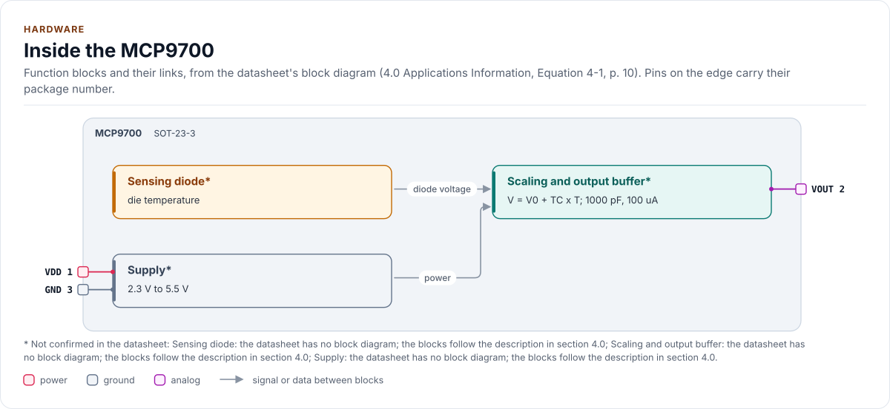
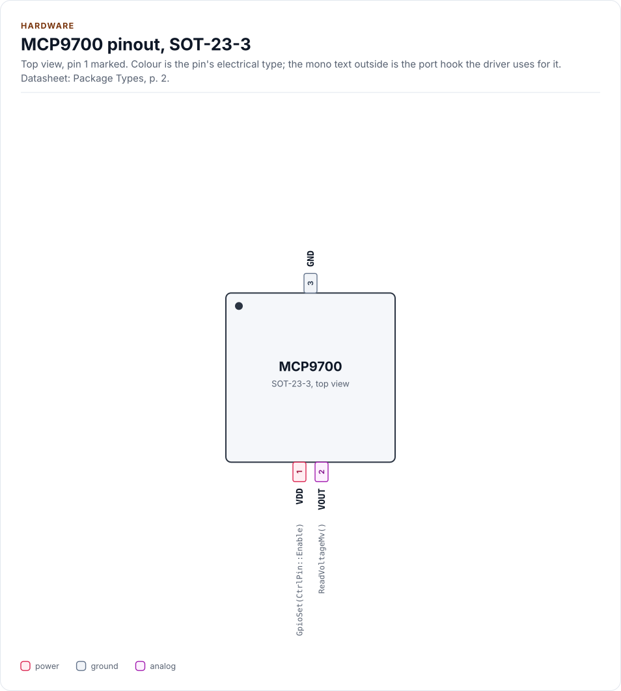
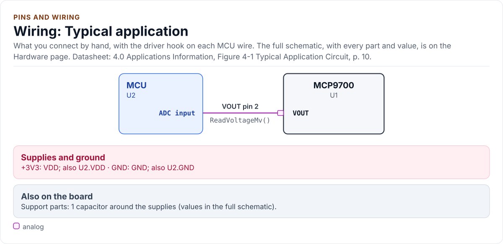
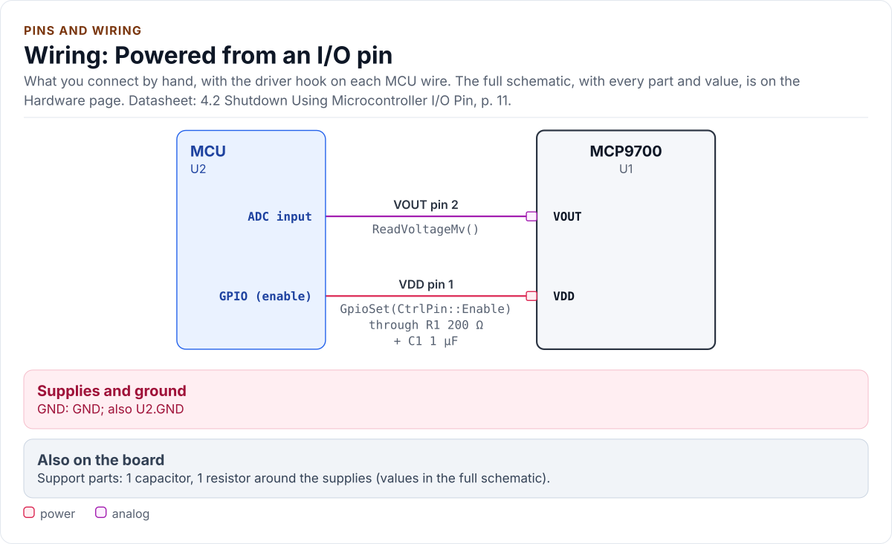
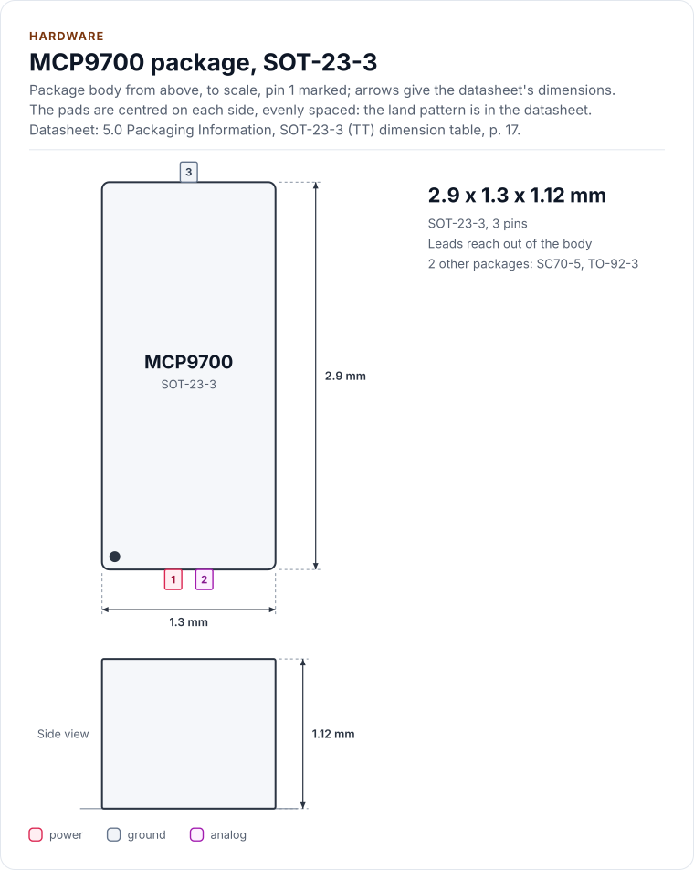

---
hide:
  - navigation
  - toc
---

Driver

# MCP970x Driver

<!-- generated: chip-summary -->
The **MCP9700** is an analog temperature sensor in a three-pin package: its output voltage rises in a straight line with
the temperature, 10.0 mV per degree from 500 mV at 0 °C, so an ADC input reads it with no other parts (Features, [p.
1](https://ww1.microchip.com/downloads/aemDocuments/documents/MSLD/ProductDocuments/DataSheets/MCP970X-Family-Data-Sheet-DS20001942.pdf#page=1)).
<!-- /generated -->

A C++20 driver for the Microchip MCP9700, MCP9700A, MCP9700B, MCP9701 and MCP9701A analog temperature sensors,
read through any MCU's ADC, with clip, noise and range checks.

[Quickstart](quickstart.md){ .md-button .md-button--primary }
[API guide](api-guide.md){ .md-button }
[Source on GitHub](https://github.com/kokeb-labs-drivers/driver-mcp9700){ .md-button }

<!-- figure: chip-hero -->
<picture>
  <source media="(prefers-color-scheme: dark)" srcset="diagrams/chip-hero.dark.svg">
  
</picture>
<!-- /figure -->

## What it does

<!-- figure: chip-capabilities -->
<picture>
  <source media="(prefers-color-scheme: dark)" srcset="diagrams/chip-capabilities.dark.svg">
  
</picture>
<!-- /figure -->

## Where it is used

<!-- generated: chip-uses -->
- Automotive
- Hard disk drives and other PC peripherals
- Entertainment systems
- Home appliance
- Office equipment
- Battery packs and portable equipment
- General purpose temperature monitoring

Uses named by the datasheet (Features, [p. 1](https://ww1.microchip.com/downloads/aemDocuments/documents/MSLD/ProductDocuments/DataSheets/MCP970X-Family-Data-Sheet-DS20001942.pdf#page=1)).
<!-- /generated -->

## Inside the sensor

<!-- figure: chip-blocks -->
<picture>
  <source media="(prefers-color-scheme: dark)" srcset="diagrams/chip-blocks.dark.svg">
  
</picture>
<!-- /figure -->

## Pins and wiring

<!-- figure: chip-pinout -->
<picture>
  <source media="(prefers-color-scheme: dark)" srcset="diagrams/chip-pinout.dark.svg">
  
</picture>
<!-- /figure -->

<!-- figure: chip-wiring-typical -->
<picture>
  <source media="(prefers-color-scheme: dark)" srcset="diagrams/chip-wiring-typical.dark.svg">
  
</picture>
<!-- /figure -->

<!-- figure: chip-wiring-gpio-powered -->
<picture>
  <source media="(prefers-color-scheme: dark)" srcset="diagrams/chip-wiring-gpio-powered.dark.svg">
  
</picture>
<!-- /figure -->

<!-- figure: chip-outline -->
<picture>
  <source media="(prefers-color-scheme: dark)" srcset="diagrams/chip-outline.dark.svg">
  
</picture>
<!-- /figure -->

The pin tables, the full schematic and the timing are on [Hardware](hardware.md).

## Driver coverage

<!-- generated: chip-coverage -->
| Capability | What the chip does | Driver API | Registers | Status | Datasheet |
| --- | --- | --- | --- | --- | --- |
| [Linear temperature output](transfer-function.md) | Turns the output voltage into milli-degrees with the datasheet's first-order equation, in integers | `ReadTemperatureMilliC`, `ReadMeasurement`, `ReadOutputMv` | - | Supported | 4.0, [p. 10](https://ww1.microchip.com/downloads/aemDocuments/documents/MSLD/ProductDocuments/DataSheets/MCP970X-Family-Data-Sheet-DS20001942.pdf#page=10) |
| Five devices | The MCP9700, 9700A, 9700B, 9701 and 9701A with their slopes, offsets, ranges and accuracy grades | `Variant`, `GetSpec` | - | Supported | DC Electrical Characteristics, [p. 3](https://ww1.microchip.com/downloads/aemDocuments/documents/MSLD/ProductDocuments/DataSheets/MCP970X-Family-Data-Sheet-DS20001942.pdf#page=3) |
| Temperature classes | Extended range, or +150 °C on the MCP9700 and MCP9700B High option; a reading outside it is refused | `TemperatureClass::High`, `Error::OutputLow`, `Error::OutputHigh` | - | Supported | Temperature Characteristics, [p. 4](https://ww1.microchip.com/downloads/aemDocuments/documents/MSLD/ProductDocuments/DataSheets/MCP970X-Family-Data-Sheet-DS20001942.pdf#page=4) |
| Direct ADC connection | VOUT goes straight to an ADC pin; the driver averages conversions and refuses a clipped or noisy line | `ReadVoltageMv`, `ReadRawPortMv`, `Error::Saturated`, `Error::Unstable` | - | Supported | Features, [p. 1](https://ww1.microchip.com/downloads/aemDocuments/documents/MSLD/ProductDocuments/DataSheets/MCP970X-Family-Data-Sheet-DS20001942.pdf#page=1) |
| One-point calibration | Removes the sensor's offset with one reading at a known temperature, as the datasheet advises | `offset_cal_mc` | - | Supported | 4.1, [p. 10](https://ww1.microchip.com/downloads/aemDocuments/documents/MSLD/ProductDocuments/DataSheets/MCP970X-Family-Data-Sheet-DS20001942.pdf#page=10) |
| Power from an I/O pin | Switches the sensor's supply from an MCU pin to save current; 800 µs typical turn-on | `Sleep`, `GpioSet`, `CtrlPin::Enable` | - | Supported | 4.2, [p. 11](https://ww1.microchip.com/downloads/aemDocuments/documents/MSLD/ProductDocuments/DataSheets/MCP970X-Family-Data-Sheet-DS20001942.pdf#page=11) |
| Nonlinearity compensation | A look-up table can bring the accuracy to ±0.5 °C typical; the driver leaves the ±0.5 °C curve in the result | - | - | Not covered | 4.1, [p. 10](https://ww1.microchip.com/downloads/aemDocuments/documents/MSLD/ProductDocuments/DataSheets/MCP970X-Family-Data-Sheet-DS20001942.pdf#page=10) |
| Self-heating | 0.179 °C at the worst case at 25 °C; the driver does not correct it | - | - | Not covered | 4.4, [p. 11](https://ww1.microchip.com/downloads/aemDocuments/documents/MSLD/ProductDocuments/DataSheets/MCP970X-Family-Data-Sheet-DS20001942.pdf#page=11) |

**Supported**: the driver covers it and a host test checks it; **Not covered**: the chip has it and the driver leaves it
alone.

From [`docs/hardware.yml`](hardware.yml); `kokeb-docs hardware --check` confirms that every API name is in
`inc/mcp9700.hpp`, `inc/mcp9700_types.hpp`, `inc/mcp9700_adc_interface.hpp`.
<!-- /generated -->

The driver has no platform code. You give it a small class that reads one ADC channel in millivolts; it does the
rest: power-up timing, averaging, the clip, noise and range checks, and the transfer function in integers. Other
linear active thermistor ICs with a first-order output (V = V0 + TC x T) work through an explicit `Custom` variant
that you declare completely.

## What you get

- **One object per sensor**, no I/O until `EnsureInitialized()`. See [API guide](api-guide.md).
- **The whole family as data**: one variant table, no branch on a part name, plus the explicit `Custom` variant.
  See [Configuration](configuration.md).
- **Integers only**: milli-degrees and millivolts, with one optional `ToCelsius()` for printing. See
  [Transfer function](transfer-function.md).
- **A reading you can trust**: dummy conversions, averaging, clip (`Saturated`), noise (`Unstable`) and range
  (`OutputLow`, `OutputHigh`) checks, never a retry and never a clamp. See [Architecture](architecture.md).
- **Errors you can act on**: `Result<T>` with an `Error`. See [Contract](contract.md).
- **Zero-overhead portability**: a CRTP port checked by a concept, one required hook for the ADC. See
  [Porting](porting.md).
- **Tested without hardware** against an independent model of the sensor and the ADC, and fuzzed. See
  [Testing and CI](testing.md). What a bench still has to confirm is in [Limitations](limitations.md).

## Datasheet

<!-- generated: datasheet-card -->
| Document | Revision | Get it |
| --- | --- | --- |
| Datasheet: MCP970X Low-Power Linear Active Thermistor ICs (Microchip Technology Inc. DS20001942) | L, 2024-02 | [PDF](https://ww1.microchip.com/downloads/aemDocuments/documents/MSLD/ProductDocuments/DataSheets/MCP970X-Family-Data-Sheet-DS20001942.pdf) · [vendor page](https://www.microchip.com/en-us/product/MCP9700) |

Written against these revisions; the SHA-256 of each file is in [`docs/datasheets.yml`](datasheets.yml). Where each part
of the driver is in the datasheet: [Datasheet map](datasheet.md).
<!-- /generated -->
