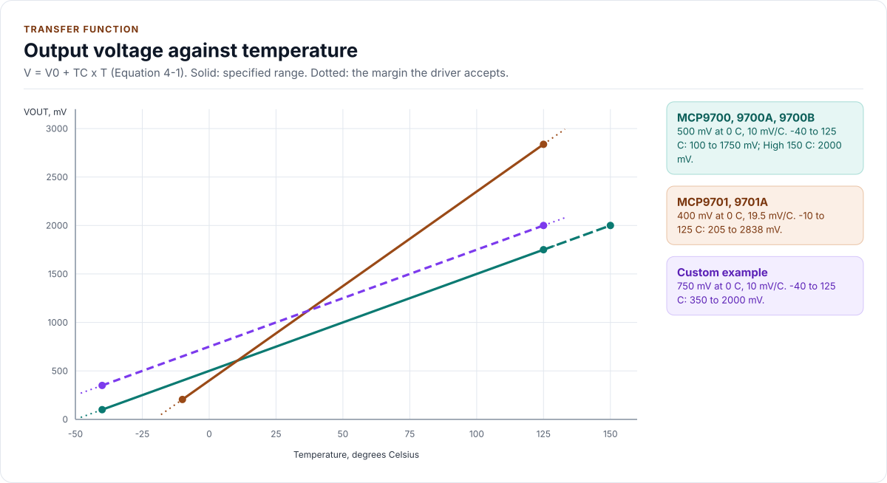

# Transfer function

How a voltage at VOUT becomes a temperature: the datasheet's equation, the integer arithmetic the driver uses, the
numbers at the ends of each range and what limits the accuracy of the result.

<!-- generated: datasheet-refs -->
??? abstract "Datasheet sections this page relies on"

    From Microchip Technology Inc. DS20001942 L:

    - Accuracy of each device: DC Electrical Characteristics, Sensor Accuracy, [p. 3](https://ww1.microchip.com/downloads/aemDocuments/documents/MSLD/ProductDocuments/DataSheets/MCP970X-Family-Data-Sheet-DS20001942.pdf#page=3)
    - Transfer function: V0 and TC of each device: 4.0 Applications Information, Equation 4-1; DC Electrical Characteristics, [p. 10](https://ww1.microchip.com/downloads/aemDocuments/documents/MSLD/ProductDocuments/DataSheets/MCP970X-Family-Data-Sheet-DS20001942.pdf#page=10)

    All of them, with the driver API for each: [Datasheet map](datasheet.md).
<!-- /generated -->

## The equation

The sensor measures the die temperature with a diode and scales it to a voltage (Equation 4-1, p. 10):

**V<sub>OUT</sub> = T<sub>C</sub> x T<sub>A</sub> + V<sub>0 °C</sub>**

| Family | V0 at 0 °C | TC | Source |
| --- | --- | --- | --- |
| MCP9700, MCP9700A, MCP9700B | 500 mV | 10.0 mV/°C | DC Electrical Characteristics, p. 3 and p. 4 |
| MCP9701, MCP9701A | 400 mV | 19.5 mV/°C | the same tables |

The values are typical; the datasheet gives no minimum or maximum for either, only the accuracy of the result
(below). The datasheet's note 3 on p. 3 points at "Equation 4-2" for the first-order equation, but Equation 4-2 is the
self-heating equation: the transfer function is Equation 4-1. The driver follows Equation 4-1.

<!-- figure: transfer-function -->
<picture>
  <source media="(prefers-color-scheme: dark)" srcset="diagrams/transfer-function.dark.svg">
  
</picture>
<!-- /figure -->

## The arithmetic

The driver works in integers only: temperatures in milli-degrees (`_mc`), voltages in millivolts (`_mv`) and the
slope in microvolts per degree (`_uv_per_c`). Solving Equation 4-1 for the temperature, with the mean output V in
millivolts:

```text
T_mc = round( (V_mv - V0_mv) x 1000000 / TC_uv_per_c )
```

The mean, the divider and the equation are one integer expression with a single rounding at the end (half away from
zero), so averaging eight conversions never adds a rounding step. It is evaluated in 64 bits. The reverse,
`MilliCToOutputMv()`, rounds to the nearest millivolt and returns 0 for a temperature whose output would be negative.

| Temperature | MCP9700 family | MCP9701 family |
| --- | --- | --- |
| -40 °C | 100 mV | (below range) |
| -10 °C | 400 mV | 205 mV |
| 0 °C | 500 mV | 400 mV |
| +25 °C | 750 mV | 887.5 mV |
| +85 °C | 1350 mV | 2057.5 mV |
| +125 °C | 1750 mV | 2837.5 mV |
| +150 °C (High) | 2000 mV | (no High option) |

Datasheet p. 9 gives the output ranges as 100 mV to 1.75 V (MCP9700 family) and 200 mV to 3 V (MCP9701 family);
the second is rounded: 205 mV and 2837.5 mV are the exact ends of -10 °C and +125 °C.

The window of `OutputLow` and `OutputHigh` is the specified range plus `range_margin_mc` on each side (default 8 °C):
for an MCP9700 that is -48 °C to +133 °C, 20 mV to 1830 mV (2080 mV with the High option). The margin is the
datasheet's worst-case +6 °C error plus 2 °C of ADC error (open question A-4); see
[Configuration](configuration.md#the-window).

`ToCelsius()` converts milli-degrees to a `float` for printing. It is the only floating-point in the driver; the
result of every call is an integer.

## The error budget

The reading is the sensor's error plus the ADC's, and the driver reports the sum without correcting for either:

| Source | Size | Where it is described |
| --- | --- | --- |
| Sensor accuracy | ±1 °C to ±4 °C by grade and span, at VDD = 3.3 V (MCP9700 family) or 5.0 V (MCP9701 family) | [Hardware](hardware.md#accuracy), `AccuracyLimitsFor()` |
| Nonlinearity | ±0.5 °C typical, 0 to +70 °C | not corrected; [Limitations](limitations.md) |
| Line regulation | 0.1 °C per volt away from the tested supply | not corrected; [Limitations](limitations.md) |
| Self-heating | 0.179 °C at the worst case, 25 °C | not corrected |
| ADC step | `ResolutionMilliC()`, 81 m°C for a 12-bit 3.3 V ADC on a 10 mV/°C part | [Hardware](hardware.md#the-adc-in-front-of-it) |
| ADC offset and gain | whatever your ADC has; calibrated millivolts remove most of it | your port |
| Noise | averaged away by `samples`; flagged by `max_spread_mv` | [Configuration](configuration.md) |

When a part is off by a fixed amount, measure it once at a known temperature and set `offset_cal_mc`: a one-point
calibration at +25 °C improves the accuracy to about ±0.5 °C from 0 to +70 °C (section 4.1, p. 10), and the
datasheet notes that a relative change from the calibration point is accurate to the same degree. A calibration at
one point cannot fix the slope; a gain trim is not part of this version ([Limitations](limitations.md)).
